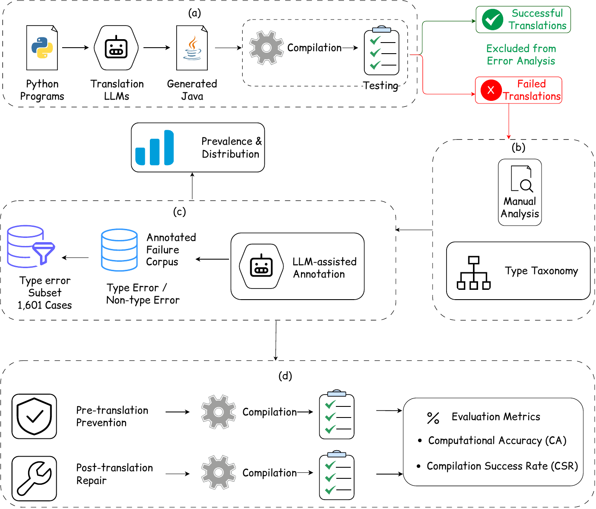

# Type-error

## Description

This repository provides the research artifact for **An Empirical Study of Type Errors in LLM-Based Python-to-Java Translation**. The study investigates type-error prevalence, taxonomy, LLM-assisted identification, prevention, and repair using Magicoder-S-DS-6.7B, Qwen2.5-Coder-7B, and Qwen2.5-Coder-32B across four benchmarks.

<a href="results/fig/fig_1.pdf"></a>

## Datasets

The dataset release contains only [`dataset/type_error_dataset.jsonl`](dataset/type_error_dataset.jsonl): **1,601 failed Python-to-Java translation cases labeled as type errors**. It uses UTF-8 JSON Lines, with one JSON object per line. Each record is a translation case, rather than a distinct Python program.

| Field | Meaning |
|---|---|
| `id` | Integer record identifier, unique within this release |
| `model` | Translation model that produced the Java code: `Magicoder-S-DS-6.7B`, `Qwen7B`, or `Qwen32B` |
| `dataset` | Source benchmark: `CodeNet`, `AVATAR`, `TransCoder`, or `XCodeEval` |
| `source_file` | Original Python source filename |
| `target_file` | Generated Java translation filename |
| `source_code` | Original Python program |
| `translated_code` | Original failed Java translation, before repair |
| `Error message` | Compilation, runtime, or output-mismatch feedback associated with the failure; the field name includes a space |
| `label_0` | Binary annotation; every record in this positive-only release has the value `type error` |
| `label_1` | Optional fine-grained category annotation; an empty string means no category is provided |
| `label_source` | Annotation origin: `manual_initial`, `manual_review`, `ai_round1`, or `ai_round2` |
| `note` | Additional annotation notes or explanations; may be empty |

`manual_initial` denotes the initial manual annotation, and `manual_review` denotes later human review. `ai_round1` and `ai_round2` denote model-consensus labels from the corresponding annotation round; these remain silver labels rather than individually human-verified labels.

Fine-grained annotations are partial. The populated `label_1` values in this file are `precision_range_error` (numeric range/precision), `incompatible_type_error` (type declaration mismatch), and `invalid_type_operation` (invalid type operation). This file is not a complete four-category gold-standard evaluation set.

Prevention and repair read this file directly and select cases by the `model` field: 517 Magicoder, 536 Qwen7B, and 548 Qwen32B cases.

The source benchmarks are [CodeNet](https://github.com/IBM/Project_CodeNet), [AVATAR](https://github.com/wasiahmad/AVATAR), [TransCoder](https://github.com/facebookresearch/TransCoder), and [xCodeEval](https://github.com/ntunlp/xCodeEval). Large test resources and model weights are obtained separately as described in the [benchmark resource instructions](#benchmark-resources).

## Repository Structure

```text
Type-error/
├── dataset/
│   └── type_error_dataset.jsonl
├── configs/                 # Experiment parameters and prompt snapshots
├── src/
│   ├── translation/         # Qwen and Magicoder generation
│   ├── evaluation/          # Four benchmark-specific test runners
│   ├── identification/      # LLM identification and agreement grouping
│   ├── repair/              # Qwen post-translation repair
│   └── analysis/            # Metrics and result analysis
└── results/                 # Archived results, figures, and paper tables
```

## Installation

Use Python 3.10 or later and install the dependencies:

```bash
python -m pip install -r requirements.txt
```

Local generation additionally requires model weights and compatible inference dependencies. Java evaluation requires a JDK, configured through `--jdk-bin`, `JAVA_HOME`, or `PATH`. For local inference, also install `torch`, `transformers`, `accelerate`, and `modelscope` with versions compatible with your model and hardware. Download the weights for [Magicoder](https://huggingface.co/ise-uiuc/Magicoder-S-DS-6.7B), [Qwen7B](https://huggingface.co/Qwen/Qwen2.5-Coder-7B-Instruct), or [Qwen32B](https://huggingface.co/Qwen/Qwen2.5-Coder-32B-Instruct). For identification, set `GPT_API_KEY`, `GEMINI_API_KEY`, or `OPUS_API_KEY` in your shell; see [.env.example](.env.example). The runners do not automatically load `.env` files. Provider endpoints can be overridden with `--base-url`.

## Usage

### Benchmark resources

<details>
<summary>Obtain external test resources</summary>

Large test resources and generated Java collections are obtained separately. Match the selected programs and task identifiers to the archived records; an upstream download alone does not reconstruct the exact study selection.

| Benchmark | Resource source | Expected local test resource |
|---|---|---|
| CodeNet | [Download instructions](https://github.com/IBM/Project_CodeNet#download-the-dataset) | Selected submissions, problem mapping, and paired `<program>_in.txt` / `<program>_out.txt` files (or numbered `_in_<case>.txt` / `_out_<case>.txt` pairs) |
| AVATAR | [Test cases](https://github.com/wasiahmad/AVATAR/tree/main/test_cases) | Paired `<program>_<case>.in` and `<program>_<case>.out` files |
| TransCoder | [Evaluation release](https://github.com/facebookresearch/TransCoder#validation-and-test-sets-release), [test scripts](https://github.com/facebookresearch/TransCoder/tree/main/data/evaluation/geeks_for_geeks_successful_test_scripts) | Detokenized Python functions and matching Java templates; fill the templates with generated methods before evaluation |
| xCodeEval | [Dataset files](https://huggingface.co/datasets/NTU-NLP-sg/xCodeEval/tree/main) | Python translation inputs and `unittest_db.json`, preserving the `src_uid` association |

Set `--external-data-root` to your resource directory, following the paths in `configs/baseline/` and `configs/evaluation/`, or override individual input paths. The test runners accept `--test-case-dir` (CodeNet/AVATAR), `--filled-dir` (TransCoder), and `--unittest-db` (xCodeEval). Use the same four runners for all translation models and prompt conditions.

</details>

Run commands from the repository root. The main script entry points are:

| Task | Script or directory |
|---|---|
| Qwen translation and P0/P1/P2 prevention | [`translate_qwen.py`](src/translation/translate_qwen.py) |
| Magicoder translation and P0/P1/P2 prevention | [`translate_magicoder.py`](src/translation/translate_magicoder.py) |
| Compilation and benchmark testing | [`src/evaluation/`](src/evaluation/) |
| GPT, Gemini, and Opus identification | [`src/identification/`](src/identification/) |
| R0/R1/R2 repair with Qwen | [`qwen7b_repair.py`](src/repair/qwen7b_repair.py) |
| Metrics, time analysis, and result comparison | [`src/analysis/`](src/analysis/) |

Preview representative configurations without loading models, calling APIs, or executing Java:

```bash
python src/translation/translate_qwen.py --config configs/prevention/qwen7b_p2.json --dry-run
python src/translation/translate_magicoder.py --config configs/prevention/magicoder_p2.json --dry-run
python src/identification/gpt.py --config configs/identification/evaluation/gpt_zero_shot.json --dry-run
python src/evaluation/test_avatar_translations.py --config configs/evaluation/avatar.json --dry-run
python src/repair/qwen7b_repair.py --config configs/repair/qwen7b_r2.json --dry-run
```

Remove `--dry-run` to execute after preparing the required inputs. For local generation, provide `--model-path /path/to/model`. CLI arguments override JSON settings; relative paths are resolved against the repository root. Qwen and Magicoder use sampling with `temperature=0.7`, `top_p=0.95`, `top_k=10`, and `max_new_tokens=8192`.

Reanalyze the included prevention and repair results without running models:

```bash
python src/analysis/analyze_experiment_results.py --config configs/analysis/historical_results.json
```

See [`configs/INDEX.json`](configs/INDEX.json) for all configurations and entry points, and [`configs/README.md`](configs/README.md) for configuration conventions. Use `--input` and the relevant resource/output arguments to override saved paths. Identification inputs require `source_code`, `translated_code`, and, for error-feedback prompting, `Error message`; include `gold` or `label_0` for evaluation.

## Results

| Study component | Included artifacts |
|---|---|
| RQ1/RQ2 | Results are provided in [`dataset/type_error_dataset.jsonl`](dataset/type_error_dataset.jsonl), including type-error labels and available category annotations |
| RQ3 | [GPT-5.4 five-strategy and Gemini/Opus selected-strategy predictions](results/rq3/): seven sets of 215 samples |
| RQ4 | [Prevention generation records, compact test records, and summaries](results/rq4/) |
| RQ5 | [Repair generation records, compact test records, and summaries](results/rq5/) |
| Discussion 2 | [Original software metrics and LOC/CC result tables](results/discussion/dis2/) |
| Discussion 4 | [Fine-grained predictions and metrics](results/discussion/dis4/): three sets of 70 samples |

Paper table snapshots are available in [`results/tables/`](results/tables/).

Figures: [workflow](results/fig/fig_1.pdf), [prevention prompts](results/fig/fig_2.pdf), [repair prompts](results/fig/fig_3.pdf), [adverse case](results/fig/fig_4.pdf), and [improvement case](results/fig/fig_5.pdf).

Archived results and current runner configurations are distinct. Exact historical seeds, weight revisions, and environment versions are not fully recovered. Full generated Java collections and the assembled 215-case binary-identification input are not bundled. Archived predictions and gold labels support result reanalysis; new identification runs require preparing the corresponding source-code inputs. Current runner prompts may differ from historical runs; consult each configuration's `experiment` metadata for evidence and unresolved settings.

Please cite *An Empirical Study of Type Errors in LLM-Based Python-to-Java Translation* when using this artifact.
